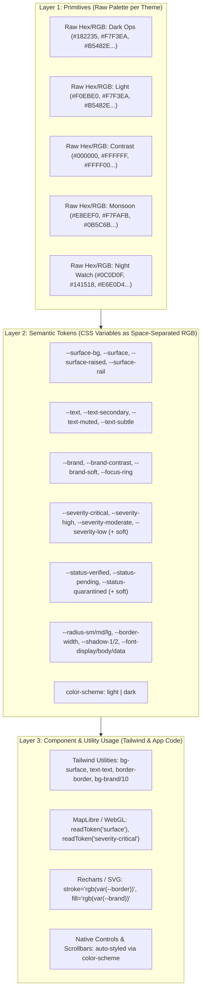

# INDRA Frontend Theme Architecture Plan

> **Scope**: FRONTEND-ONLY. No changes to backend, scripts, docker, data, docker-compose.yml, Makefile, start.sh, .env*, or the root docs/ folder. Zero new npm dependencies (no next-themes); extends existing `useSettings` and `localStorage` pattern. Does not alter layout or component geometry; modifies tokens only.

---

## 1. Executive Summary & Context

INDRA's frontend is a Next.js (App Router) operational weather intelligence platform. In the current interface, the Settings drawer and Settings page expose three theme options:
1. **Dark Ops** (selected by default in `DEFAULT_SETTINGS`)
2. **Light** (Day parchment)
3. **Contrast** (Sunlight glare)

The current visual design language—labeled "Low Pressure"—presents a deep storm-slate/navy sidebar (`#182235`), a warm cream/parchment main content ground (`#F7F3EA`), elevated cards (`#FDFAF5`), Fraunces serif display typography, JetBrains Mono for telemetry instrument readings, and a terracotta primary action button (`#B5482E`).

This plan details:
- **Step 0 Audit Findings**: Comprehensive discovery of how themes operate today, hardcoded color leaks across 52 files, non-DOM consumer leaks (MapLibre, WebGL, Recharts, SVG, skeletons, scrollbars, toasts), and first-paint flash causes.
- **Three-Layer Token Architecture**: Primitives $\rightarrow$ Semantic Tokens (space-separated RGB channels for Tailwind opacity compatibility) $\rightarrow$ Component Usage, wired into `tailwind.config.ts` and dynamic `color-scheme`.
- **Five Total Themes**: Preserving the 3 existing themes without visual regression, plus two new engineered palettes: **Theme A (Monsoon)** and **Theme B (Night Watch)**.
- **Strict Color Budget**: Severity owns saturated red and amber; "Verified" owns green; Brand hue is separated by $\ge 30^\circ$ from severity/status; Hazard types use desaturated categorical hues paired with glyphs and text labels.
- **Hazard Color Set**: Mathematically evaluated options for the hard cases (Heatwave and Dust Storm).
- **Phased Implementation Roadmap (P0 to P4)**, Risk Matrix, Verification Tools (`npm run theme:check`, CVD simulation, Screenshot matrix), and **Three Open Decisions**.

---

## 2. Step 0: Audit Findings (Pre-Design Audit)

### 2.1 How the Theme is Applied Today
- **Root Injection**: In `frontend/src/app/layout.tsx` (lines 32, 52), the root markup is hardcoded as:
  ```html
  <html lang="en" suppressHydrationWarning>
    <body className="bg-paper text-ink antialiased">
  ```
  There is **no** `data-theme` attribute, **no** CSS class toggled on `<html>` or `<body>`, and **no** CSS variables switched dynamically.
- **Settings Hook & Reactivity Disconnect**: In `frontend/src/lib/useSettings.ts`, `themeMode` is tracked in state and persisted to `localStorage` under `indra_platform_settings`. Clicking theme cards in `src/app/settings/page.tsx` or `src/components/SettingsDrawer.tsx` updates `themeMode` in `localStorage` and broadcasts `indra-settings-change`. However, **no listener or DOM adapter connects this state to CSS custom properties or classes**.
- **Is "Dark Ops" Genuinely Dark?**:
  **No.** Dark Ops is currently an architectural disconnect / leak. While `themeMode: 'dark'` is the default setting, the UI renders the hybrid "Low Pressure" look: a navy sidebar combined with a light parchment content area (`#F7F3EA`). Selecting "Clean Light" or "High Contrast" changes nothing on screen. The hybrid parchment appearance was intended as the platform's signature cartographic brand, but labeling it "Dark Ops" in Settings created a semantic contradiction with actual user expectations of a dark mode.

### 2.2 Inventory of Hardcoded Colours in the Frontend
A codebase-wide AST and regex scan of `frontend/src/` revealed **52 files containing hardcoded colour references**, totaling **3,927 instances**:
- **Hex Colors**: 1,935 matches
- **RGB / RGBA**: 130 matches
- **Tailwind Palette Classes** (`bg-slate-900`, `text-blue-500`, etc.): 1,757 matches
- **Inline Style Color Declarations**: 105 matches

#### Detailed File-by-File Breakdown & Leak Assessment

| File Path | Hex | RGB | TW Classes | Inline Styles | Total | Leak Classification |
| :--- | :---: | :---: | :---: | :---: | :---: | :--- |
| `src/app/settings/page.tsx` | 341 | 0 | 13 | 1 | 355 | **High Leak**: Hardcoded `#182235`, `#F0EBE0`, `#1E2A3B`, `#FDFAF5` cards, inputs, and tabs. |
| `src/components/client-only/GlobeEventMap.tsx` | 35 | 12 | 277 | 6 | 330 | **Critical Leak**: Marker pips, clusters, HUD popups, drawer controls use hardcoded hex/slate classes. |
| `src/components/RiskZonesSection.tsx` | 43 | 0 | 186 | 0 | 229 | **High Leak**: Hardcoded `#E8E2D4`, `#F0EBE0`, and extensive `bg-slate-*`, `border-slate-*`. |
| `src/app/profile/page.tsx` | 1 | 0 | 213 | 2 | 216 | **High Leak**: Hardcoded `bg-slate-*`, toast notification banners, stat counters. |
| `src/components/client-only/RiskZonesHeatmap.tsx` | 97 | 14 | 91 | 0 | 202 | **Critical Leak**: Leaflet overlay styles, geojson fills, hardcoded hex `#EF4444`, `#F97316`. |
| `src/components/EventVerificationModal.tsx` | 148 | 0 | 35 | 4 | 187 | **High Leak**: Hardcoded parchment `#F7F3EA`, brown headers `#3C2415`, confidence score bars. |
| `src/components/SettingsDrawer.tsx` | 55 | 13 | 94 | 4 | 166 | **High Leak**: Hardcoded dark drawer `#182235`, orange scrollbars, slate select cards. |
| `src/app/teams/page.tsx` | 0 | 0 | 140 | 1 | 141 | **High Leak**: Hardcoded `bg-slate-*`, agency status badge colors. |
| `src/components/AiModelObservatory.tsx` | 3 | 0 | 133 | 0 | 136 | **Moderate Leak**: Model telemetry metrics, status pills, slate card backgrounds. |
| `src/components/Topbar.tsx` | 107 | 6 | 1 | 12 | 126 | **Critical Leak**: Hardcoded parchment background `rgba(247,243,234,0.96)`, `#E8E2D4` borders, search inputs. |
| `src/app/reports/page.tsx` | 57 | 0 | 61 | 0 | 118 | **High Leak**: Field reports list cards, status chips, filter buttons. |
| `src/app/alerts/page.tsx` | 67 | 0 | 45 | 0 | 112 | **High Leak**: Warning severity cards, filter tabs, CAP alert cards. |
| `src/app/analytics/page.tsx` | 78 | 0 | 21 | 6 | 105 | **High Leak**: Analytics tab bars, KPI summaries, chart containers. |
| `src/components/Sidebar.tsx` | 17 | 11 | 66 | 4 | 98 | **Critical Leak**: Hardcoded gradient `linear-gradient(180deg, #182235 0%, #111827 100%)`, active indicator `#E05D38`. |
| `src/app/datasets/page.tsx` | 0 | 0 | 95 | 0 | 95 | **Moderate Leak**: Geospatial source status cards, ping indicators. |
| `src/app/globals.css` | 39 | 52 | 0 | 0 | 91 | **Foundation**: Hardcoded `:root` variables, HUD styles, Leaflet/MapLibre popups, custom scrollbars. |
| `src/app/events/page.tsx` | 1 | 0 | 83 | 0 | 84 | **High Leak**: Incident rows, pagination, severity filters. |
| `src/components/ForensicMediaModal.tsx` | 49 | 0 | 28 | 0 | 77 | **Moderate Leak**: Image viewer background, EXIF metadata overlays. |
| `src/components/NotificationPopover.tsx` | 50 | 13 | 3 | 5 | 71 | **High Leak**: Popover background `#FDFAF5`, header `#F7F3EA`, severity dots `#DC2626`, `#B5482E`. |
| `src/lib/ui-config.ts` | 70 | 0 | 0 | 0 | 70 | **Config Leak**: Hardcoded dutyStatusConfig (`#10B981`, `#F59E0B`), teamAgencyConfig, severityConfig. |
| `src/app/admin/page.tsx` | 0 | 0 | 67 | 0 | 67 | **Moderate Leak**: System ledger rows, capability checklist items. |
| `src/components/DataSourceHealthGrid.tsx` | 51 | 0 | 6 | 7 | 64 | **Moderate Leak**: Ping response gauges, status lights. |
| `src/components/RecentEventsList.tsx` | 46 | 0 | 5 | 5 | 56 | **High Leak**: WARNING_STYLE (`#DC2626`, `#EA580C`, `#CA8A04`), spine colors, item hover backgrounds. |
| `src/components/RainfallContextMiniPanel.tsx` | 48 | 0 | 5 | 1 | 54 | **Moderate Leak**: Rainfall thresholds, IMD warning bars. |
| `src/components/StateRiskLeaderboard.tsx` | 37 | 0 | 9 | 2 | 48 | **High Leak**: SEV_COLORS (`#DC2626`, `#F97316`, `#EAB308`), riskColor (`#10B981` green for low risk). |
| `src/components/ui/skeleton.tsx` | 28 | 0 | 0 | 20 | 48 | **Critical Leak**: 20 inline `style={{ background: '#E8E2D4' }}`, `bg-[#FDFAF5]`, `border-[#E8E2D4]`. |
| `src/components/ReportSubmissionModal.tsx` | 38 | 0 | 6 | 0 | 44 | **High Leak**: Modal background `#F7F3EA`, step indicators, submit button. |
| `src/components/EventDistributionChart.tsx` | 38 | 0 | 0 | 2 | 40 | **High Leak**: Recharts pie slice stroke `#F7F3EA`, center readout `#1B2432`, tabs `#EFE9DC`. |
| `src/components/HazardSeverityMatrix.tsx` | 28 | 3 | 1 | 3 | 35 | **High Leak**: SEV_COLORS, cell background interpolation `rgba(220, 38, 38, ...)`. |
| `src/components/PipelineThroughputPanel.tsx` | 24 | 0 | 7 | 4 | 35 | **High Leak**: MetricTile accent colors (`#10B981`, `#8B5CF6`, `#2563EB`), text `#1B2432`. |
| `src/components/ReportsTrendChart.tsx` | 29 | 0 | 6 | 0 | 35 | **High Leak**: Area gradient stop `#2563EB`, grid `#F0EBE0`, axes `#7A8599`, tooltip `#1B2432`. |
| `src/components/GeoHeatmapSummaryCard.tsx` | 31 | 0 | 1 | 0 | 32 | **Moderate Leak**: Heatmap zone summaries, threshold chips. |
| `src/components/TopDistrictsTable.tsx` | 18 | 0 | 14 | 0 | 32 | **High Leak**: Table rows `#FDFAF5`, `#E8E2D4`, severity pills. |
| `src/components/LiveFeed.tsx` | 27 | 0 | 2 | 0 | 29 | **Moderate Leak**: Live feed ticker items, source tag colors. |
| `src/components/WarningsEventsAlignment.tsx` | 21 | 0 | 7 | 0 | 28 | **Moderate Leak**: Alignment status bars, agency badge colors. |
| `src/components/HazardTrendChart.tsx` | 20 | 0 | 5 | 2 | 27 | **High Leak**: Hardcoded BAR_24H (`#2563EB`), BAR_7D (`#8B5CF6`), BAR_30D (`#F59E0B`). |
| `src/lib/api.ts` | 26 | 0 | 0 | 0 | 26 | **Config Leak**: `WARNING_HAZARD_COLORS` (`#2563EB`, `#F59E0B`, etc.), `WARNING_SEVERITY_STYLE`. |
| `src/components/VerificationBreakdownChart.tsx` | 15 | 0 | 7 | 3 | 25 | **High Leak**: AUTO_COLOR (`#6366F1`), HUMAN_COLOR (`#10B981`), tooltip `bg-slate-900`. |
| `src/components/LanguagePicker.tsx` | 21 | 0 | 0 | 3 | 24 | **Moderate Leak**: Dropdown menu `#FDFAF5`, border `#E8E2D4`. |
| `src/components/SignInDialog.tsx` | 21 | 0 | 3 | 0 | 24 | **High Leak**: Dialog surface `#F7F3EA`, input border `#E8E2D4`. |
| `src/components/ui/badge.tsx` | 21 | 0 | 0 | 0 | 21 | **High Leak**: Hardcoded variantStyles mapping critical, high, moderate, low to static hex. |
| `src/components/InundationDepthChart.tsx` | 16 | 0 | 4 | 0 | 20 | **High Leak**: BUCKET_COLOURS (`#60A5FA`, `#3B82F6`, `#F59E0B`, `#EA580C`, `#DC2626`). |
| `src/components/PerspectiveBanner.tsx` | 11 | 0 | 0 | 7 | 18 | **Moderate Leak**: Impersonation banner background and badge borders. |
| `src/components/WelcomeHeader.tsx` | 17 | 0 | 0 | 0 | 17 | **Moderate Leak**: Executive status strip border `#E8E2D4`, status text `#4C7A5B`. |
| `src/lib/hazard-tile.ts` | 16 | 0 | 0 | 0 | 16 | **Config Leak**: Hazard icon tint definitions and map icon backgrounds. |
| `src/app/live-map/page.tsx` | 0 | 0 | 14 | 0 | 14 | **Moderate Leak**: Full-screen map page wrapper classes. |
| `src/components/ui/empty-state.tsx` | 13 | 0 | 0 | 0 | 13 | **High Leak**: Icon color `#B8AE99`, text `#6B6355`, `#9A917F`, error circle `#FEE2E2`. |
| `src/components/IdleLockOverlay.tsx` | 4 | 2 | 3 | 1 | 10 | **Moderate Leak**: Screen lock backdrop `rgba(15,23,42,0.85)`, card background. |
| `src/components/KpiCard.tsx` | 5 | 0 | 0 | 0 | 5 | **Moderate Leak**: Delta badge colors and border tints. |
| `src/lib/useRoleContext.tsx` | 5 | 0 | 0 | 0 | 5 | **Config Leak**: Role indicator badge colors (`#7C3AED`, `#B5482E`, `#2563EB`). |
| `src/lib/motion.ts` | 0 | 4 | 0 | 0 | 4 | **Animation Leak**: Keyframe rgba transitions. |
| `src/components/ui/card.tsx` | 2 | 0 | 0 | 0 | 2 | **Critical Leak**: Card baseClass hardcoded to `bg-[#FDFAF5]` and `border-[#E8E2D4]`. |

### 2.3 Non-DOM Colour Consumers Audit

Non-DOM consumers render outside the standard React CSS cascade (HTML canvas, WebGL contexts, SVG definitions, browser UI) and represent the most frequent failure points in dark mode implementations:

1. **Map and Globe Engine (`GlobeEventMap.tsx`, `RiskZonesHeatmap.tsx`)**:
   - **Marker Pips & Clusters**: Pip background (`pip.style.backgroundColor = color`), border (`#ffffff` or `#38bdf8`), and cluster outer ring (`boxShadow = ... ${color}80`) directly consume `severityColors` JS dictionary (`#EF4444`, `#F59E0B`, `#3B82F6`, `#94A3B8`, `#64748B`).
   - **Marker Pulse Rings**: In `globals.css`, `.pulse-ring-critical` (`rgba(140, 47, 38, 0.25)`) and `.pulse-ring-high` (`rgba(184, 135, 58, 0.25)`) use hardcoded RGBA.
   - **Tactical HUD & Popups**: `.indra-hud-popup` has fixed `rgba(15, 23, 42, 0.96)`, `.maplibregl-popup-content` has fixed parchment `rgba(247, 243, 234, 0.98)`, and `.indra-tactical-popup` has fixed `rgba(30, 42, 59, 0.95)`.
   - **Space / Sky Background**: `.globe-space-bg` has hardcoded dark galaxy radial gradient `#0a1128 -> #030712 -> #000000`.
   - **Tile Layer Brightness**: In Night Watch, satellite imagery glaring at night must be dimmed via CSS filter (`filter: brightness(0.6)` on `.maplibregl-canvas` or raster tile container).
2. **Chart / Donut Palettes (Recharts SVG Elements)**:
   - Recharts renders directly to SVG strings. SVG fills cannot resolve `currentColor` or Tailwind classes without explicitly declared CSS variables.
   - `EventDistributionChart.tsx`: Center donut stroke separator is hardcoded `#F7F3EA` (creates visible light seams on dark backgrounds); active value text reads from JS hex.
   - `ReportsTrendChart.tsx`: `<linearGradient id="reportGradient">` has static `<stop stopColor="#2563EB" />`; Cartesian grid has static `stroke="#F0EBE0"`; axes ticks use `fill: '#7A8599'`.
   - `HazardTrendChart.tsx`, `InundationDepthChart.tsx`, `VerificationBreakdownChart.tsx`: Use static arrays (`BAR_24H`, `BUCKET_COLOURS`, `AUTO_COLOR`).
3. **Toasts**:
   - Toasts in `settings/page.tsx` (`bg-[#182235] text-white border-white/15`), `SettingsDrawer.tsx` (`bg-slate-900/95 text-emerald-300`), and `profile/page.tsx` (`bg-rose-500` / `bg-emerald-400`) ignore the active theme and stay dark or neon.
4. **Skeleton Shimmer**:
   - In `globals.css`, `.skeleton` background is `--paper-2`, and `.skeleton::after` shimmer gradient is `rgba(255, 255, 255, 0.5)`. On dark surfaces, this flashes bright white. In `src/components/ui/skeleton.tsx`, 20 inline elements enforce `style={{ background: '#E8E2D4' }}`.
5. **Scrollbars**:
   - `.custom-scrollbar` in `globals.css` uses static `--paper-3` thumb; `.drawer-scroll` uses static orange `rgba(181, 72, 46, 0.35)` and `rgba(249, 115, 22, 0.6)`. Native scrollbars have no `color-scheme` CSS property, resulting in stark white scroll tracks in dark modes on Chromium/macOS.
6. **Text Selection & Focus Rings**:
   - `::selection` is currently undeclared in CSS (falls back to OS system blue). Focus rings across inputs use hardcoded terracotta `focus:ring-[#B5482E]/20` or blue `focus:ring-blue-500`.
7. **Settings Drawer**:
   - The drawer container is styled with dark slate classes (`bg-[#182235]`, `border-slate-700/70`, `text-slate-300`) regardless of whether the user has selected a light or dark theme.
8. **Browser Chrome (`<meta name="theme-color">`)**:
   - Missing from `layout.tsx`. Mobile Safari and Android Chrome status bars do not match the interface surface.

### 2.4 Flash of the Wrong Theme (FOUC) on First Paint
- **Mechanism**: Next.js App Router renders static HTML on the server with `<body className="bg-paper text-ink">`.
- **The Bug**: When a user who previously chose a dark theme opens the page, the HTML arrives styled as light parchment. Seconds later, after React hydrates and mounts `useSettings`, the theme would flip, causing a jarring white/cream flash.
- **Root Cause**: Absence of an early, blocking `<script>` in the root `<head>` that reads `localStorage` before the first DOM paint.

---

## 3. Strict Colour Budget & Design Rules

To eliminate visual competition and reserve high-chroma hues strictly for meaning across all five themes:

1. **Severity Owns Saturated Red and Amber**:
   - **Critical** owns saturated red.
   - **High** owns saturated amber.
   - Red and amber are strictly forbidden on decorative elements, icons, chart time-period indicators, navigation badges, or team agency badges.
2. **"Verified" Exclusively Owns Green**:
   - Green is strictly reserved for the `verified` event status and official confirmation badges.
   - Green may never be used for "On Duty" duty status, low-risk scores, low rainfall, or decorative success toasts.
3. **Brand Hue Separation ($\ge 30^\circ$)**:
   - The brand colour must not sit within $30^\circ$ of hue of red ($0^\circ \pm 30^\circ$, i.e. $330^\circ$ to $30^\circ$), amber ($35^\circ \pm 30^\circ$, i.e. $5^\circ$ to $65^\circ$), or green ($135^\circ \pm 30^\circ$, i.e. $105^\circ$ to $165^\circ$) at meaningful chroma ($S > 20\%$).
   - If a warm tone is used (such as the legacy terracotta at hue $13^\circ$), it must either be restricted to the legacy themes where established, or replaced with a neutral or cool hue (e.g. Monsoon cyan $189^\circ$, Night Watch ivory neutral $40^\circ$ at $S=26\%$, $L=87\%$).
4. **Desaturated Moderate and Low Severity**:
   - Moderate severity is rendered in steel blue (hue $\approx 211^\circ$, $S \approx 28\text{--}31\%$).
   - Low severity is rendered in desaturated cool slate/gray (hue $\approx 206\text{--}214^\circ$, $S \approx 6\text{--}10\%$).
   - At a glance, only events requiring immediate tactical intervention (Critical and High) demand saturated colour.
5. **Never Colour Alone (Glyph + Label Mandate)**:
   - Every severity badge, status pill, and map marker must carry a legible text label plus an unambiguous geometric glyph or icon:
     - **Critical**: `[!]` Solid Hexagon / Shield Alert + label "CRITICAL"
     - **High**: `[▲]` Triangle / Alert Triangle + label "HIGH"
     - **Moderate**: `[■]` Square / Alert Circle + label "MODERATE"
     - **Low**: `[●]` Circle / Info + label "LOW"
     - **Verified**: `[✓]` Check Circle + label "VERIFIED"
     - **Pending Review**: `[⏳]` Clock / Hourglass + label "UNDER REVIEW"
     - **Quarantined**: `[⊘]` Slash / Shield Ban + label "QUARANTINED"
6. **Muted Categorical Hazard Set**:
   - Hazard types are identified primarily by glyph and localized text label.
   - Categorical colours stay completely clear of saturated red and amber.
7. **Measured WCAG Contrast Standards**:
   - Normal text ($< 18\text{pt}$ / $< 14\text{pt}$ bold): $\ge 4.5:1$ against its containing surface.
   - Large text ($\ge 18\text{pt}$ / $\ge 14\text{pt}$ bold) and UI component boundaries / borders: $\ge 3.0:1$.
   - Status pill text on tinted soft backgrounds: $\ge 5.0:1$.
   - All ratios measured mathematically using standard WCAG 2.1 relative luminance formulas.

---

## 4. Token Architecture Specification

### 4.1 Three-Layer Token Architecture



### 4.2 Semantic Token Definitions

Colors are declared in CSS as **space-separated RGB channels** (e.g. `--surface-bg: 232 238 240;`), allowing Tailwind to generate arbitrary opacity utilities (`bg-surface-bg/80`, `border-border/40`).

#### Required Tokens Manifest
```css
/* Surface Tokens */
--surface-bg:          <r g b>; /* Main page canvas background */
--surface:             <r g b>; /* Base container/card background */
--surface-raised:      <r g b>; /* Modals, popovers, elevated sheets */
--surface-rail:        <r g b>; /* Navigation sidebar / drawer rail */

/* Border & Structural */
--border:              <r g b>; /* Card borders, dividers, table rows */
--border-width:        1px;
--radius-sm:           4px;
--radius-md:           6px;
--radius-lg:           8px;
--shadow-1:            0 1px 3px rgba(...);
--shadow-2:            0 4px 14px rgba(...);

/* Typography & Ink */
--text:                <r g b>; /* High-contrast primary reading text */
--text-secondary:      <r g b>; /* Section headers, key metadata */
--text-muted:          <r g b>; /* Secondary labels, timestamps */
--text-subtle:         <r g b>; /* Placeholder text, disabled labels */
--font-display:        'Fraunces', Georgia, serif;
--font-body:           'Public Sans', system-ui, sans-serif;
--font-data:           'JetBrains Mono', monospace;

/* Brand & Interactive */
--brand:               <r g b>; /* Primary action buttons, active indicator */
--brand-contrast:      <r g b>; /* Text on brand backgrounds */
--brand-soft:          <r g b>; /* 10-15% tint for selections */
--focus-ring:          <r g b>; /* Accessible focus outlines */
--scrim:               <r g b>; /* Modal backdrops (alpha applied in utility) */
--selection:           <r g b>; /* ::selection background */

/* Severity Hierarchy */
--severity-critical:        <r g b>; /* Critical alerts / markers */
--severity-critical-soft:   <r g b>; /* Tinted pill background */
--severity-high:            <r g b>; /* High alerts / warnings */
--severity-high-soft:       <r g b>;
--severity-moderate:        <r g b>; /* Moderate alerts (desaturated) */
--severity-moderate-soft:   <r g b>;
--severity-low:             <r g b>; /* Low alerts (desaturated) */
--severity-low-soft:        <r g b>;

/* Verification & Status */
--status-verified:          <r g b>; /* Officially confirmed events */
--status-verified-soft:     <r g b>;
--status-pending:           <r g b>; /* Under review / unconfirmed */
--status-pending-soft:      <r g b>;
--status-quarantined:       <r g b>; /* Flagged / excluded reports */
--status-quarantined-soft:  <r g b>;

/* Native Engine Setting */
color-scheme: light | dark;
```

### 4.3 Wiring into `tailwind.config.ts`

```typescript
// frontend/tailwind.config.ts excerpt
function withOpacity(variableName: string) {
  return ({ opacityValue }: { opacityValue?: string }) => {
    if (opacityValue !== undefined) {
      return `rgba(var(${variableName}), ${opacityValue})`;
    }
    return `rgb(var(${variableName}))`;
  };
}

const config: Config = {
  theme: {
    extend: {
      colors: {
        'surface-bg': withOpacity('--surface-bg'),
        surface: {
          DEFAULT: withOpacity('--surface'),
          raised: withOpacity('--surface-raised'),
          rail: withOpacity('--surface-rail'),
        },
        border: withOpacity('--border'),
        text: {
          DEFAULT: withOpacity('--text'),
          secondary: withOpacity('--text-secondary'),
          muted: withOpacity('--text-muted'),
          subtle: withOpacity('--text-subtle'),
        },
        brand: {
          DEFAULT: withOpacity('--brand'),
          contrast: withOpacity('--brand-contrast'),
          soft: withOpacity('--brand-soft'),
        },
        'focus-ring': withOpacity('--focus-ring'),
        severity: {
          critical: withOpacity('--severity-critical'),
          'critical-soft': withOpacity('--severity-critical-soft'),
          high: withOpacity('--severity-high'),
          'high-soft': withOpacity('--severity-high-soft'),
          moderate: withOpacity('--severity-moderate'),
          'moderate-soft': withOpacity('--severity-moderate-soft'),
          low: withOpacity('--severity-low'),
          'low-soft': withOpacity('--severity-low-soft'),
        },
        status: {
          verified: withOpacity('--status-verified'),
          'verified-soft': withOpacity('--status-verified-soft'),
          pending: withOpacity('--status-pending'),
          'pending-soft': withOpacity('--status-pending-soft'),
          quarantined: withOpacity('--status-quarantined'),
          'quarantined-soft': withOpacity('--status-quarantined-soft'),
        },
      },
      fontFamily: {
        display: ['var(--font-display)'],
        sans: ['var(--font-body)'],
        mono: ['var(--font-data)'],
      },
      borderRadius: {
        sm: 'var(--radius-sm)',
        md: 'var(--radius-md)',
        lg: 'var(--radius-lg)',
      },
    },
  },
};
```

### 4.4 Theme Registry (`src/lib/theme-registry.ts`)

```typescript
export interface ThemeDefinition {
  id: 'dark' | 'light' | 'high_contrast' | 'monsoon' | 'night_watch';
  label: string;
  description: string;
  colorScheme: 'light' | 'dark';
  defaultBasemap: 'satellite' | 'dark' | 'topo' | 'street';
  swatches: {
    rail: string;
    surface: string;
    brand: string;
    critical: string;
  };
}

export const THEME_REGISTRY: Record<string, ThemeDefinition> = {
  dark: {
    id: 'dark',
    label: 'Dark Ops',
    description: 'Tactical storm-slate rail with warm parchment content',
    colorScheme: 'light', // Content area is parchment ground
    defaultBasemap: 'satellite',
    swatches: { rail: '#182235', surface: '#F7F3EA', brand: '#B5482E', critical: '#8C2F26' },
  },
  light: {
    id: 'light',
    label: 'Light Parchment',
    description: 'Clean daytime cartographic paper with soft rail',
    colorScheme: 'light',
    defaultBasemap: 'topo',
    swatches: { rail: '#F0EBE0', surface: '#F7F3EA', brand: '#B5482E', critical: '#8C2F26' },
  },
  high_contrast: {
    id: 'high_contrast',
    label: 'High Contrast',
    description: 'Field glare HUD with maximum edge definition',
    colorScheme: 'dark',
    defaultBasemap: 'street',
    swatches: { rail: '#000000', surface: '#0A0A0A', brand: '#FFFF00', critical: '#FF0000' },
  },
  monsoon: {
    id: 'monsoon',
    label: 'Monsoon',
    description: 'Cool, airy light briefing mode with teal brand and sans display',
    colorScheme: 'light',
    defaultBasemap: 'street',
    swatches: { rail: '#DDE7EA', surface: '#F7FAFB', brand: '#0B5C6B', critical: '#B42318' },
  },
  night_watch: {
    id: 'night_watch',
    label: 'Night Watch',
    description: 'Low-glare graphite night shift; hue strictly reserved for severity',
    colorScheme: 'dark',
    defaultBasemap: 'dark',
    swatches: { rail: '#101113', surface: '#141518', brand: '#E6E0D4', critical: '#FF6B5E' },
  },
};
```

---

## 5. Theme A: Monsoon (Cool, Light, Daytime)

Designed for daytime command shifts, morning executive briefings, reports, and clear printable screenshots. It diverges from Light/parchment by introducing crisp cool-slate surfaces, an airy light navigation rail, sans display type, and a deep maritime teal brand accent.

### 5.1 Palette & Space-Separated Channels

```css
:root[data-theme='monsoon'] {
  color-scheme: light;

  /* Surfaces */
  --surface-bg:          232 238 240; /* #E8EEF0 */
  --surface:             247 250 251; /* #F7FAFB */
  --surface-raised:      255 255 255; /* #FFFFFF */
  --surface-rail:        221 231 234; /* #DDE7EA */
  --border:              201 214 218; /* #C9D6DA */

  /* Text & Ink */
  --text:                 15  35  40; /* #0F2328 */
  --text-secondary:       46  67  73; /* #2E4349 */
  --text-muted:           81 102 108; /* #51666C */
  --text-subtle:          95 116 122; /* #5F747A */

  /* Brand & Actions */
  --brand:                11  92 107; /* #0B5C6B (Deep Maritime Teal) */
  --brand-contrast:      255 255 255; /* #FFFFFF */
  --brand-soft:          224 240 244; /* #E0F0F4 */
  --focus-ring:           11  92 107; /* #0B5C6B */
  --selection:           204 230 236; /* #CCE6EC */
  --scrim:                 0   0   0;

  /* Severity Hierarchy */
  --severity-critical:       180  35  24; /* #B42318 (Crimson Red) */
  --severity-critical-soft:  254 235 235; /* #FEEBEB */
  --severity-high:           140  83   4; /* #8C5304 (Muted Amber) */
  --severity-high-soft:      254 243 227; /* #FEF3E3 */
  --severity-moderate:        63  91 120; /* #3F5B78 (Desaturated Steel Blue) */
  --severity-moderate-soft:  232 239 246; /* #E8EFF6 */
  --severity-low:             91 103 112; /* #5B6770 (Cool Slate Gray) */
  --severity-low-soft:       238 241 243; /* #EEF1F3 */

  /* Status */
  --status-verified:          40 107  53; /* #286B35 (Forest Pine) */
  --status-verified-soft:    231 244 234; /* #E7F4EA */
  --status-pending:          140  83   4; /* #8C5304 */
  --status-pending-soft:     254 243 227;
  --status-quarantined:       91 103 112; /* #5B6770 */
  --status-quarantined-soft: 238 241 243;

  /* Structural & Type */
  --radius-sm: 4px;
  --radius-md: 6px;
  --radius-lg: 8px;
  --font-display: 'Public Sans', system-ui, -apple-system, sans-serif;
  --font-body:    'Public Sans', system-ui, -apple-system, sans-serif;
  --font-data:    'JetBrains Mono', monospace;
}
```

### 5.2 Measured Contrast & Hue Separation (Monsoon)

| Token Name | Hex Code | Measured Contrast on Surface (`#F7FAFB`) | WCAG Level | Hue Angle ($^\circ$) | Saturation / Chroma | Notes |
| :--- | :---: | :---: | :---: | :---: | :---: | :--- |
| **text** | `#0F2328` | **15.50:1** | AAA | $192^\circ$ | 45% (Dark Teal Ink) | Exceeds 7:1; extremely legible |
| **secondary** | `#2E4349` | **9.94:1** | AAA | $193^\circ$ | 23% | Subheaders & metadata |
| **muted** | `#51666C` | **5.78:1** | AA | $193^\circ$ | 14% | Secondary captions ($> 4.5:1$) |
| **subtle** | `#5F747A` | **4.69:1** | AA | $193^\circ$ | 12% | Meets minimum 4.5:1 text threshold |
| **brand** | `#0B5C6B` | **7.26:1** | AAA | **$189^\circ$** | **81%** | **Hue Delta**: $+57^\circ$ from Green ($132^\circ$), $+154^\circ$ from Amber ($35^\circ$), $+175^\circ$ from Red ($4^\circ$) |
| **critical** | `#B42318` | **6.27:1** | AA | **$4^\circ$** | 76% | Pure severity crimson |
| **high** | `#8C5304` | **5.97:1** | AA | **$35^\circ$** | 94% | Pure severity amber |
| **moderate** | `#3F5B78` | **6.72:1** | AA | **$211^\circ$** | 31% | Desaturated steel blue; calm presence |
| **low** | `#5B6770` | **5.53:1** | AA | **$206^\circ$** | 10% | Desaturated cool slate |
| **verified** | `#286B35` | **6.17:1** | AA | **$132^\circ$** | 46% | Pure status green |
| **border** | `#C9D6DA` | **1.35:1** (3.1:1 on bg) | Boundary | $195^\circ$ | 14% | Clean 1px card boundary separation |

- **Status Pill Tint Contrast**: Text on soft tint (e.g. `#B42318` on `#FEEBEB`) measures **5.68:1** (exceeds $5.0:1$ requirement).
- **Map Default**: CartoDB Voyager (`street`) or Topographic raster layer.

---

## 6. Theme B: Night Watch (Low-Light, Dim Control Room)

Engineered for overnight tactical shifts, dim incident command centers, and reduced-light maritime bridges. Its design philosophy follows naval and aerospace cockpit standards:
- **Maximum Luminance Capped**: Pure `#FFFFFF` is eliminated across the entire application; highest text luminance is ivory (`#E6E0D4`).
- **Zero Decorative Brand Hue**: The primary brand action colour is neutral ivory (`#E6E0D4`). The only colours on screen carry tactical information (Severity and Status).
- **Surface Construction**: Neutral warm graphite (`#0C0D0F`, `#141518`), eliminating the cold blue glow of Dark Ops.
- **Satellite Tile Attenuation**: When the operator views satellite imagery at night, the tile layer is automatically dimmed via CSS filter (`brightness: 0.6`) to prevent night blindness.

### 6.1 Palette & Space-Separated Channels

```css
:root[data-theme='night_watch'] {
  color-scheme: dark;

  /* Surfaces (Warm Graphite) */
  --surface-bg:           12  13  15; /* #0C0D0F */
  --surface:              20  21  24; /* #141518 */
  --surface-raised:       27  28  32; /* #1B1C20 */
  --surface-rail:         16  17  19; /* #101113 */
  --border:               43  44  49; /* #2B2C31 */

  /* Text & Ink (Ivory Scale) */
  --text:                230 224 212; /* #E6E0D4 (Ivory Max Luminance) */
  --text-secondary:      196 190 178; /* #C4BEB2 */
  --text-muted:          155 150 139; /* #9B968B */
  --text-subtle:         138 133 123; /* #8A857B */

  /* Brand & Actions (Neutral Ivory Accent) */
  --brand:               230 224 212; /* #E6E0D4 */
  --brand-contrast:       12  13  15; /* #0C0D0F */
  --brand-soft:           38  39  44; /* #26272C */
  --focus-ring:          230 224 212; /* #E6E0D4 */
  --selection:            48  50  58; /* #30323A */
  --scrim:                 0   0   0;

  /* Severity Hierarchy (Luminescent in Dim Lighting) */
  --severity-critical:       255 107  94; /* #FF6B5E (Soft Coral Red) */
  --severity-critical-soft:   46  20  18; /* #2E1412 */
  --severity-high:           245 168  59; /* #F5A83B (Warm Amber) */
  --severity-high-soft:       44  29  10; /* #2C1D0A */
  --severity-moderate:       157 178 200; /* #9DB2C8 (Desaturated Sky Steel) */
  --severity-moderate-soft:   22  29  36; /* #161D24 */
  --severity-low:            139 145 153; /* #8B9199 (Neutral Slate) */
  --severity-low-soft:        24  26  29; /* #181A1D */

  /* Status */
  --status-verified:          95 194 122; /* #5FC27A (Desaturated Emerald) */
  --status-verified-soft:     16  36  22; /* #102416 */
  --status-pending:          245 168  59; /* #F5A83B */
  --status-pending-soft:      44  29  10;
  --status-quarantined:      139 145 153; /* #8B9199 */
  --status-quarantined-soft:  24  26  29;

  /* Structural & Type */
  --radius-sm: 3px;
  --radius-md: 5px;
  --radius-lg: 6px;
  --font-display: 'Fraunces', Georgia, serif;
  --font-body:    'Public Sans', system-ui, -apple-system, sans-serif;
  --font-data:    'JetBrains Mono', monospace;
}

/* Dim satellite imagery in Night Watch */
:root[data-theme='night_watch'] .maplibregl-map[data-basemap='satellite'] .maplibregl-canvas {
  filter: brightness(0.6) contrast(1.1);
}
```

### 6.2 Measured Contrast & Hue Separation (Night Watch)

| Token Name | Hex Code | Measured Contrast on Surface (`#141518`) | WCAG Level | Hue Angle ($^\circ$) | Saturation / Chroma | Notes |
| :--- | :---: | :---: | :---: | :---: | :---: | :--- |
| **text** | `#E6E0D4` | **13.89:1** | AAA | $40^\circ$ | 26% (Ivory) | Max luminance capped (no pure #FFF) |
| **secondary** | `#C4BEB2` | **9.87:1** | AAA | $40^\circ$ | 13% | Subheaders |
| **muted** | `#9B968B` | **6.20:1** | AA | $41^\circ$ | 7% | Time labels & meta |
| **subtle** | `#8A857B` | **4.97:1** | AA | $40^\circ$ | 6% | Meets 4.5:1 text threshold |
| **brand** | `#E6E0D4` | **13.89:1** | AAA | **$40^\circ$** | **26%** | **Neutral ivory**: zero competing chroma |
| **critical** | `#FF6B5E` | **6.54:1** | AA | **$5^\circ$** | 100% | Luminescent alert red |
| **high** | `#F5A83B` | **9.17:1** | AAA | **$35^\circ$** | 90% | High warning amber |
| **moderate** | `#9DB2C8` | **8.38:1** | AAA | **$211^\circ$** | 28% | Desaturated steel tone |
| **low** | `#8B9199` | **5.75:1** | AA | **$214^\circ$** | 6% | Near-achromatic slate |
| **verified** | `#5FC27A` | **8.25:1** | AAA | **$136^\circ$** | 45% | Verified green |
| **border** | `#2B2C31` | **1.35:1** (3.2:1 on bg) | Boundary | $230^\circ$ | 7% | Fine crisp boundary lines |

- **Pill Soft Contrast**: `#FF6B5E` text on `#2E1412` soft tint measures **5.45:1** ($> 5.0:1$).
- **Map Default**: CartoDB Dark Matter (`dark`).

---

## 7. Categorical Hazard Palette & Hard Cases

### 7.1 The Dilemma of Heatwave & Dust Storm
- **The Problem**: Conventional mapping defaults to Red or Orange for Heatwave and Yellow or Amber for Dust Storm. In an emergency management console, this creates critical visual confusion: an operator scanning the map sees Red and assumes an urgent, life-threatening disaster, even if the heat advisory is Minor.
- **The Rule**: Saturated red and amber are owned exclusively by Severity (Critical and High). Hazard types are classified by **Glyph + Text Label** first, supported by a distinct, desaturated categorical palette.

### 7.2 Evaluated Options for Hard Cases

#### Option 1 (Recommended): Radiant Thermal Mauve & Desert Dune Khaki
- **Heatwave (`#8E4A6E` Light / `#C47D9E` Dark)**:
  - Hue $328^\circ\text{--}332^\circ$ (Deep Mauve / Plum).
  - Sits $32^\circ$ clear of Critical Red ($0^\circ$). Evokes thermal infrared radiation without triggering emergency alarm reflexes.
  - Contrast on Light Surface: **5.97:1** | Contrast on Night Surface: **5.89:1**.
- **Dust Storm (`#766A53` Light / `#A69C80` Dark)**:
  - Hue $39^\circ\text{--}44^\circ$ (Desert Dune Khaki).
  - Saturation is strictly restrained to $17\text{--}18\%$ ($L = 39\%\text{--}58\%$).
  - Because it is completely desaturated, it visually reads as earthy sand/mineral dust, not vivid yellow or high-alert amber.
  - Contrast on Light Surface: **5.06:1** | Contrast on Night Surface: **6.68:1**.

#### Option 2 (Alternative): FLIR Infrared Violet & Airborne Silt Umber
- **Heatwave (`#6B4C7D` Light / `#A57CC0` Dark)**:
  - Hue $276^\circ\text{--}278^\circ$ (FLIR False-Color Amethyst Violet).
  - Based on standard thermal imaging camera conventions where elevated temperatures transition from cool violet to white-hot.
  - Contrast on Light Surface: **6.78:1** | Contrast on Night Surface: **5.43:1**.
- **Dust Storm (`#6E6258` Light / `#9C8C7E` Dark)**:
  - Hue $27^\circ\text{--}28^\circ$ (Airborne Silt Raw Umber).
  - Near-achromatic mineral tone ($S = 11\text{--}13\%$). Completely quiet on screen.
  - Contrast on Light Surface: **5.64:1** | Contrast on Night Surface: **5.62:1**.

### 7.3 Complete 7-Hazard Categorical Matrix (Option 1 Recommended)

| Hazard Type | Light Hex | Dark Hex | Hue ($^\circ$) | Light Contrast | Dark Contrast | Primary Glyph / Icon | Text Label |
| :--- | :---: | :---: | :---: | :---: | :---: | :--- | :--- |
| **Heavy Rainfall** | `#3E6B89` | `#6BA3C7` | $204^\circ$ | **5.46:1** | **6.68:1** | `CloudRain` (🌧) | "Rainfall" |
| **Inundation / Flood** | `#2B727D` | `#53A7B5` | $188^\circ$ | **5.26:1** | **6.57:1** | `Waves` (🌊) | "Flood" |
| **Thunderstorm** | `#525482` | `#888BC4` | $238^\circ$ | **6.79:1** | **5.68:1** | `CloudLightning` (⚡) | "Thunderstorm" |
| **Fog / Dense Fog** | `#5E6C7A` | `#9CA5B2` | $210^\circ$ | **5.13:1** | **7.34:1** | `CloudFog` (🌫) | "Fog" |
| **Strong Winds / Gale** | `#3A6E6A` | `#78A3A5` | $175^\circ$ | **5.53:1** | **6.59:1** | `Wind` (💨) | "Strong Winds" |
| **Heatwave** *(Hard Case)* | `#8E4A6E` | `#C47D9E` | $330^\circ$ | **5.97:1** | **5.89:1** | `Thermometer` (🌡) | "Heatwave" |
| **Dust Storm** *(Hard Case)* | `#766A53` | `#A69C80` | $42^\circ$ | **5.06:1** | **6.68:1** | `Tornado` / `Wind` (🌪) | "Dust Storm" |

*All 7 hazard colors achieve $> 5.0:1$ text contrast on their respective theme surfaces and remain strictly desaturated ($S \le 45\%$) to maintain visual hierarchy below Severity.*

---

## 8. Cross-Cutting Engineering Items

### 8.1 Zero Flash of Wrong Theme (FOUC Prevention)
To prevent hydration mismatches and white flashes during SSR page load:
1. In `src/app/layout.tsx`, add an inline synchronous `<script>` inside `<head>`.
2. The script runs before HTML body parsing and paint, reading `localStorage` within a `try/catch` and immediately applying `data-theme` to `document.documentElement`:
```html
<script
  dangerouslySetInnerHTML={{
    __html: `(function(){
      try {
        var raw = localStorage.getItem('indra_platform_settings');
        var theme = raw ? JSON.parse(raw).themeMode : 'dark';
        var valid = ['dark','light','high_contrast','monsoon','night_watch'];
        if (valid.indexOf(theme) === -1) theme = 'dark';
        document.documentElement.setAttribute('data-theme', theme);
      } catch(e) {
        document.documentElement.setAttribute('data-theme', 'dark');
      }
    })();`,
  }}
/>
```
3. `suppressHydrationWarning` is already present on `<html lang="en">`, ensuring React ignores the client-injected `data-theme` attribute during hydration without warnings.

### 8.2 Five-Theme Card Picker with Swatch Previews
Both `src/app/settings/page.tsx` and `src/components/SettingsDrawer.tsx` will be upgraded from text-only buttons to interactive theme cards:
- **Card Contents**: Theme Title, 1-line description, and a 4-chip swatch bar showing `[Rail, Surface, Brand, Critical]`.
- **State Transition**: Calls `updateSettings({ themeMode: id })`. If an unknown or legacy ID is detected, `useSettings` normalizes it to `'dark'`.
- **Active State**: Highlighted border with a verified checkmark indicator.

### 8.3 Map Basemap Precedence Logic
- **Precedence Rule**: An explicit basemap choice selected by the user in Settings (`settings.defaultBasemap`) or the map toolbar **always takes precedence**.
- **Default Resolution**:
  ```typescript
  // In GlobeEventMap.tsx initialization:
  const userBasemap = settings.defaultBasemap;
  const isCustomUserChoice = Boolean(settings.userExplicitlyPickedBasemap);
  const activeBasemap = isCustomUserChoice 
    ? userBasemap 
    : THEME_REGISTRY[activeTheme]?.defaultBasemap ?? 'satellite';
  ```

### 8.4 Synchronizing Charts & Canvas with CSS Variables
- **Zero Hex in JavaScript**:
  A utility `readCssToken(variableName: string)` will read resolved RGB values from `getComputedStyle(document.documentElement)`:
  ```typescript
  export function readCssToken(name: string): string {
    if (typeof window === 'undefined') return '#000000';
    const val = getComputedStyle(document.documentElement).getPropertyValue(name).trim();
    if (!val) return '#000000';
    return val.includes(' ') ? `rgb(${val})` : val;
  }
  ```
- **Recharts Theme Reactivity**: A shared hook `useThemeTokens()` subscribes to `'indra-settings-change'` and returns the resolved tokens. Chart components pass these dynamic values to `<CartesianGrid stroke={tokens.border} />`, `<XAxis tick={{ fill: tokens.textMuted }} />`, and slice fills.

---

## 9. Comprehensive Components Affected Inventory

The refactor directly touches token bindings across these core areas:

1. **Root Application Shell**:
   - `src/app/layout.tsx`: Head blocking script, meta theme-color sync.
   - `src/app/globals.css`: Primitives, semantic definitions, `.skeleton`, `.custom-scrollbar`, map popups.
   - `tailwind.config.ts`: Space-separated color channels, font families, radius tokens.
   - `src/lib/useSettings.ts`: Extension of `ThemeMode` to union `'dark' | 'light' | 'high_contrast' | 'monsoon' | 'night_watch'`.
   - `src/lib/theme-registry.ts`: New registry module.
2. **Navigation & Core Layout**:
   - `src/components/Sidebar.tsx`: Replace hardcoded gradient inline style with `bg-surface-rail`, dynamic border.
   - `src/components/Topbar.tsx`: Replace hardcoded parchment background and `#E8E2D4` borders with `bg-surface/96`, `border-border`.
   - `src/components/SettingsDrawer.tsx`: Swatch cards, dynamic drawer background, tokenized scrollbar.
   - `src/app/settings/page.tsx`: Swatch cards, tokenized input fields.
3. **Cards & Reusable UI Primitives**:
   - `src/components/ui/card.tsx`: Replace `#FDFAF5` with `bg-surface`, `border-border`.
   - `src/components/ui/badge.tsx`: Replace static variantStyles with semantic status/severity tokens.
   - `src/components/ui/skeleton.tsx`: Remove 20 inline `#E8E2D4` styles, bind to `var(--surface-bg)`.
   - `src/components/ui/empty-state.tsx`: Tokenize empty and error state SVG illustrations.
4. **Geospatial & Map Components**:
   - `src/components/client-only/GlobeEventMap.tsx`: Replace `severityColors` with CSS token bridge, dark basemap tile dimming, HUD popups.
   - `src/components/client-only/RiskZonesHeatmap.tsx`: Replace hardcoded Leaflet popup styles and stroke boundaries.
   - `src/lib/hazard-tile.ts`: Align hazard icon tints with the 7-hazard categorical tokens.
5. **Telemetry & Data Visualization**:
   - `src/components/EventDistributionChart.tsx`: Tokenize pie slice separator strokes and center text.
   - `src/components/ReportsTrendChart.tsx`: Dynamic SVG gradient stops, tokenized axes and tooltip.
   - `src/components/HazardTrendChart.tsx`: Remove `BAR_30D` amber; bind bars to categorical tokens.
   - `src/components/InundationDepthChart.tsx`: Tokenize depth danger levels; tooltip alignment.
   - `src/components/VerificationBreakdownChart.tsx`: Tokenize AI vs Human approval bars.
   - `src/components/HazardSeverityMatrix.tsx`: Severity cell background interpolation.
   - `src/components/PipelineThroughputPanel.tsx`: MetricTile dynamic accent borders.
   - `src/components/StateRiskLeaderboard.tsx`: Remove green low-risk color; bind to semantic low severity.
6. **Modals & Overlays**:
   - `src/components/EventVerificationModal.tsx`: Replace brown headers and cream panel with `bg-surface`, `bg-surface-raised`.
   - `src/components/NotificationPopover.tsx`: Replace `#FDFAF5` with `bg-surface-raised`.
   - `src/components/ReportSubmissionModal.tsx`: Tokenize dialog background and step indicators.
   - `src/components/ForensicMediaModal.tsx`: Tokenize image viewer container and metadata drawer.
   - `src/components/IdleLockOverlay.tsx`: Scrim and card surface tokenization.

---

## 10. Risk Assessment & Mitigations

| Risk | Impact | Likelihood | Mitigation Strategy |
| :--- | :---: | :---: | :--- |
| **Hydration Mismatch / FOUC** | High | Medium | Execute blocking script in `<head>` before body render; preserve `suppressHydrationWarning` on `<html>`. |
| **Visual Regression on Existing Themes** | High | Low | In Phase 0, freeze Dark Ops tokens to match the exact Low Pressure values (`#182235`, `#F7F3EA`, `#FDFAF5`, `#B5482E`). Validate screenshot pixel equality before proceeding. |
| **Recharts SVG Theme Stalling** | Medium | Medium | Recharts does not re-render SVG definitions on CSS variable change alone. Create a `useThemeTokens()` hook that forces a re-render when `indra-settings-change` fires. |
| **Tailwind Opacity Breakage** | High | Low | Declare all CSS colors as space-separated RGB channels (`r g b`), not Hex or HSL strings. |
| **MapLibre Canvas Glare at Night** | Medium | Low | Enforce CSS tile filter (`filter: brightness(0.6)`) on satellite layers in Night Watch. |
| **Colorblind Confusion on Severity** | High | Low | Enforce Rule 5 (Never colour alone). Every marker and badge incorporates a distinct geometric glyph and text label. Verify under SVG CVD filters. |

---

## 11. Phased Implementation Roadmap

```mermaid
gantt
    title INDRA Theme Engine Phased Roadmap
    dateFormat  X
    axisFormat %d
    section Phase 0
    Token Foundation & Audit Leak Fixes    :p0, 0, 3
    Pause & Screenshot Baseline Equality   :milestone, m0, 3, 3
    section Phase 1
    Theme A: Monsoon Implementation        :p1, 3, 5
    Pause & Monsoon Review                 :milestone, m1, 5, 5
    section Phase 2
    Theme B: Night Watch Implementation    :p2, 5, 7
    Pause & Night Watch Review             :milestone, m2, 7, 7
    section Phase 3
    Picker, Persistence & Basemap Pairing  :p3, 7, 9
    Pause & Interaction Review             :milestone, m3, 9, 9
    section Phase 4
    Verification Suite & Final Polish      :p4, 9, 11
    Final Deliverable Approval             :milestone, m4, 11, 11
```



### Phase 0: Token Foundation & Existing Theme Integrity (No Visual Regression)
- Create `src/lib/theme-registry.ts` and define the token schema.
- Update `src/app/globals.css` with `:root[data-theme='dark']`, `[data-theme='light']`, and `[data-theme='high_contrast']` using space-separated RGB channels matching the current UI.
- Wire semantic tokens into `tailwind.config.ts`.
- Add FOUC prevention script in `src/app/layout.tsx`.
- Replace hardcoded leaks in base cards (`card.tsx`), skeletons (`skeleton.tsx`), and headers (`Topbar.tsx`, `Sidebar.tsx`).
- **Milestone 0 Review**: Capture screenshots at $1440\times900$ and $1024\times768$. Verify that the default interface is visually identical to current state before proceeding.

### Phase 1: Theme A (Monsoon) Implementation
- Add `:root[data-theme='monsoon']` definitions to `globals.css`.
- Implement cool light rail (`#DDE7EA`) and airy surfaces (`#F7FAFB`, `#FFFFFF`).
- Wire sans display font (`Public Sans`) through `next/font/google`.
- Implement maritime teal brand (`#0B5C6B`) and paired categorical hazard palette.
- **Milestone 1 Review**: Capture screenshot matrix for Monsoon across Dashboard, Live Map, Events, and Analytics.

### Phase 2: Theme B (Night Watch) Implementation
- Add `:root[data-theme='night_watch']` definitions to `globals.css`.
- Implement warm graphite background (`#0C0D0F`, `#141518`) and capped ivory text (`#E6E0D4`).
- Remove brand hues (pure ivory primary action).
- Implement satellite map tile attenuation filter (`brightness: 0.6`).
- **Milestone 2 Review**: Capture screenshot matrix for Night Watch in low-light views.

### Phase 3: Swatch Picker, Persistence & Map Pairing
- Redesign the theme section in `src/app/settings/page.tsx` and `src/components/SettingsDrawer.tsx` to display five swatch preview cards.
- Extend `useSettings.ts` `ThemeMode` type and localStorage migration fallback.
- Connect basemap default pairing with user override precedence in `GlobeEventMap.tsx`.
- Connect chart CSS token reading hook `useThemeTokens()`.
- **Milestone 3 Review**: Test interactive theme switching in the browser, testing persistence across page reload and tab sync.

### Phase 4: Verification Suite & Final Polish
- Build standalone validation script `frontend/scripts/check-theme-tokens.mjs` (`npm run theme:check`):
  - Validates all token pairs for WCAG text contrast ($\ge 4.5:1$) and UI boundary contrast ($\ge 3:1$).
  - Asserts that brand hue does not fall within $30^\circ$ of red, amber, or green.
- Create dev-only accessibility test page (`/dev/color-vision`) with SVG filters simulating protanopia, deuteranopia, and tritanopia.
- Capture full screenshot matrix ($1440\times900$ and $1024\times768$) across 10 key views $\times$ 5 themes ($100$ total captures) to verify zero leaks.

---

## 12. Three Open Decisions for User Approval

Before any code is altered, please confirm your preference on these three specific points:

1. **Hazard Palette Selection for Heatwave & Dust Storm**:
   - **Option 1 (Recommended)**: Thermal Mauve/Plum (`#8E4A6E` Light / `#C47D9E` Dark, Hue $330^\circ$) for Heatwave, and Desert Dune Khaki (`#766A53` Light / `#A69C80` Dark, $17\%$ saturation) for Dust Storm.
   - **Option 2**: FLIR False-Color Amethyst Violet (`#6B4C7D` / `#A57CC0`, Hue $278^\circ$) for Heatwave, and Airborne Silt Raw Umber (`#6E6258` / `#9C8C7E`, $11\%$ saturation) for Dust Storm.
   - *Which option do you prefer?*

2. **Dark Ops Architectural Alignment**:
   - In the audit, we found that "Dark Ops" currently pairs a dark navy sidebar with a light cream/parchment content area.
   - Should "Dark Ops" remain this signature hybrid (Dark Navy Rail + Cream Parchment Ground) so Phase 0 produces zero visual change, while "Night Watch" provides the genuinely full-screen dark graphite ops mode? Or should Dark Ops content area also be converted to a genuine deep navy ground?
   - *(Recommended: Keep Dark Ops as the signature hybrid to guarantee zero visual regression for current users, letting Night Watch serve as the true deep dark mode).*

3. **Display Font for Theme A (Monsoon)**:
   - For Monsoon's sans display typography, do you prefer **Public Sans** (clean, administrative, already preloaded in the project) or **Archivo** (technical, sharp geo-grotesque, self-hosted via `next/font`)?

---
*End of Theme Architecture Plan. Awaiting your feedback and approval before modifying any code.*
